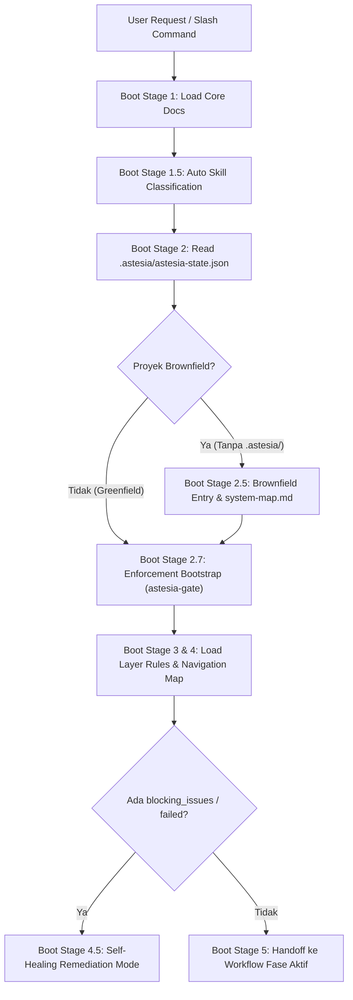
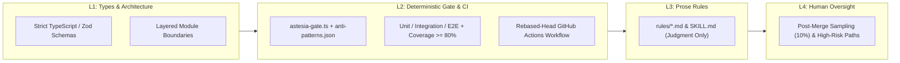

# Astesia Framework v3.0.0 — Dokumen Referensi & Dossier Audit Lengkap

**Versi Framework:** `3.0.0`  
**Status Git Terakhir:** `c0e253e` (`main`)  
**Lokasi Workspace:** `D:\Workspaces\Astesia`

Dokumen ini disusun sebagai panduan referensi menyeluruh sekaligus lembar kerja audit (*Audit Dossier*) untuk memeriksa arsitektur, alur kerja, sistem aturan, mesin verifikasi deterministik, dan katalog 53 skill native pada **Astesia Framework v3.0.0**.

---

## 1. Identitas, Filosofi & Struktur Direktori

**Astesia** adalah *Multi-Layer Autonomous Software Agency Framework* yang beroperasi sebagai plugin native di atas Google Antigravity ([plugin.json](file:///D:/Workspaces/Astesia/plugin.json), [package.json](file:///D:/Workspaces/Astesia/package.json)). Astesia mencegah perilaku AI yang langsung menulis kode mentah tanpa perencanaan (*Anti Rush-to-Code*) dan menegakkan kualitas kode melalui pendekatan **Verification-First (Trust Pyramid)**.

### Struktur Direktori Utama
```text
D:\Workspaces\Astesia\
├── plugin.json                              # Manifest plugin Google Antigravity (v3.0.0)
├── package.json                             # Metadata paket (astesia-os v3.0.0)
├── install.ps1 / install.sh                 # Installer Live-Mode (junction skills/ & rules/)
├── docs/
│   ├── astesia-persona.md                   # Identitas & temperamen Direktur Agensi
│   ├── astesia-overview.md                  # Gambaran arsitektur 5 layer & matriks keputusan
│   ├── agent-operating-guide.md             # SOP operasional agen (Step 1 s.d. Step 8)
│   └── astesia-audit-dossier.md             # Dokumen referensi & audit ini
├── runtime/
│   ├── boot-sequence.md                     # Prosedur inisialisasi agen (Boot Stage 1 - 5)
│   └── context-map.json                     # Pemetaan skill ke masing-masing layer
├── rules/
│   ├── AGENTS.md                            # Titik masuk aturan global plugin & 4 Mode Operasi
│   ├── coding-standards.md                  # Standar format, TypeScript strict, import & error
│   ├── product-rules.md                     # 6 aturan Layer 1 (Product)
│   ├── design-rules.md                      # 5 aturan Layer 2 (Design)
│   ├── engineering-rules.md                 # 29 direktif struktural Layer 3 (Engineering)
│   ├── quality-rules.md                     # 11 aturan audit & verifikasi Layer 4 (Quality)
│   └── devops-rules.md                      # 5 aturan infrastruktur & merge Layer 5 (DevOps)
├── workflows/
│   ├── phase1-product.md                    # Checklist eksekusi fase Product
│   ├── phase2-design.md                     # Checklist eksekusi fase Design
│   ├── phase3-engineering.md                # Checklist eksekusi fase Engineering (Task Waves)
│   ├── phase4-quality.md                    # Checklist eksekusi fase Quality & Gate
│   └── phase5-devops.md                     # Checklist eksekusi fase DevOps & CI
├── templates/
│   ├── astesia-state-template.json          # Skema state machine (.astesia/astesia-state.json)
│   ├── brd-template.md                      # Template Business Requirements Document
│   ├── design-system-template.md            # Template Design Tokens & UI Specs
│   ├── architecture-template.md             # Template Blueprint Arsitektur & ADR
│   ├── system-map-template.md               # Template Peta Navigasi Codebase (Brownfield)
│   ├── qa-test-plan-template.md             # Template Rencana & Laporan Audit QA
│   ├── deployment-template.md               # Template Dokumentasi Deployment
│   └── enforcement/
│       ├── astesia-gate.ts                  # Mesin pemeriksa deterministik (Layer 2 Trust Pyramid)
│       ├── anti-patterns.json               # Registri aturan anti-pattern (append-only)
│       └── astesia-gate.workflow.yml        # Template GitHub Actions CI (rebased-head check)
└── skills/
    ├── SKILL-TEMPLATE.md                    # Standar pembuatan skill baru
    ├── skills-index.md                      # Indeks katalog 53 skill
    └── <53 folder skill>/SKILL.md           # Skill native Antigravity (Progressive Disclosure)
```

### Tiga Dokumen Fondasi (`docs/`)
1. **[astesia-persona.md](file:///D:/Workspaces/Astesia/docs/astesia-persona.md):** Menetapkan 4 pilar kepribadian agen:
   * *Baseline (The Polymath Architect):* Penyelarasan bisnis–desain–teknis–kualitas–infra, pemisahan layer ketat, anti *rush-to-code*, serta efisiensi token.
   * *Critique (The Honest Partner & Agency Director):* Bukan *yes-man*; wajib mengevaluasi asumsi, memaparkan *trade-off*, menolak permintaan kabur, adaptif terhadap proyek legacy (*brownfield*), dan menuntut *testability*.
   * *Bias (Quality over Speed):* Lebih takut *technical debt* daripada lambat; membenci abstraksi berlebih (*over-engineering*).
   * *Temperament:* Tajam namun objektif, tidak defensif, mampu mengoreksi diri (*self-correcting*), presisi tinggi (TDD), dan ekstra ringkas (*extreme conciseness*).
2. **[astesia-overview.md](file:///D:/Workspaces/Astesia/docs/astesia-overview.md):** Memuat prinsip inti, definisi 5 layer kognitif, matriks *trade-off* (*Monolith vs Microservices*, *SSR vs CSR*), rekomendasi *default stack* (Bun/Elysia/Hono/Go, Drizzle ORM, PostgreSQL, SvelteKit/Vue, Docker Compose), strategi *scaling* 3 fase (0–1K, 1K–50K, 50K+ user), serta kontrak direktori `.astesia/`.
3. **[agent-operating-guide.md](file:///D:/Workspaces/Astesia/docs/agent-operating-guide.md):** Mengatur 8 langkah operasi agen:
   * *Step 1:* Intersepsi Slash Command (`/astesia-init`, `/astesia-product`, `/astesia-product-audit`, `/astesia-design`, `/astesia-engineering`, `/astesia-quality`, `/astesia-devops`).
   * *Step 1.5:* Klasifikasi skill otomatis & pencatatan ke `active_skills[]`.
   * *Step 2:* Pemuatan aturan layer & verifikasi state (`blocking_issues[]`, `completed_artifacts[]`, `retry_count`).
   * *Step 2.5:* RAG Memory & Semantic Context untuk codebase $>50$ file.
   * *Step 3:* Orkestrasi *Three Brains* (*Planner → Parallel Executors → QA Auditor*) & transisi otomatis antar-fase.
   * *Step 4:* Pemisahan tanggung jawab (*Separation of Concerns*) antar-layer.
   * *Step 5:* *Pre-Handoff Self-Correction Audit* (maksimal 2 siklus koreksi internal).
   * *Step 6:* *Error Recovery & Infinite Loop Protection* (Git Auto-Snapshot, Hash Convergence Guard, batas 3 retry, Auto-Rollback, dan *Anti-Silent Failure Protocol*).
   * *Step 7:* *Extreme Token Efficiency* (Dynamic Skill Pruning, Output Scope Control, Targeted Reading untuk file $>500$ baris).
   * *Step 8:* *Verification-First Principle & Trust Pyramid*.

---

## 2. Alur Inisialisasi (Boot Sequence) & 4 Mode Operasi



### Empat Mode Operasi ([AGENTS.md](file:///D:/Workspaces/Astesia/rules/AGENTS.md))
| Mode | Skenario Penggunaan | Urutan Alur Eksekusi |
|---|---|---|
| **Mode A: Full Lifecycle** | Proyek Greenfield Full-Stack (Web/Mobile + Backend) | `Product (L1) → Design (L2) → Engineering (L3) → Quality (L4) → DevOps (L5)` |
| **ModeB: Headless / Backend-First** | REST API, CLI, Microservice, Library (tanpa UI) | `Product (L1) → Engineering (L3) → Quality (L4) → DevOps (L5)` *(Design dilewati)* |
| **Mode C: Surgical / Hotfix** | Perbaikan bug spesifik atau perubahan terisolasi pada proyek Brownfield | `Blast Radius → TDD Unit Test → Minimalist Fix → Verification Gate → Merge Check` |
| **Mode D: Audit & Gardening** | Pembersihan technical debt, peningkatan aturan lint, atau refactoring | `Debt Scanner + Astesia Gate → Codebase Gardening Wave → Ratchet Rules` |

---

## 3. Rincian 5 Layer Kognitif, Aturan, Workflow & Kontrak `.astesia/`

Setiap proyek yang dikelola Astesia wajib memiliki direktori `.astesia/` dengan state yang mengikuti [astesia-state-template.json](file:///D:/Workspaces/Astesia/templates/astesia-state-template.json).

### Layer 1: Product / Business Layer
* **Peran:** Product Manager (PM) & Business Analyst (BA)
* **Berkas:** [product-rules.md](file:///D:/Workspaces/Astesia/rules/product-rules.md) | [phase1-product.md](file:///D:/Workspaces/Astesia/workflows/phase1-product.md) | [brd-template.md](file:///D:/Workspaces/Astesia/templates/brd-template.md)
* **Output Artefak:** `.astesia/brd.md`
* **6 Aturan Utama:**
  1. Dilarang menulis detail implementasi (kode, SQL, CSS).
  2. Wajib menyertakan *Acceptance Criteria* yang dapat diuji untuk setiap fitur.
  3. Wajib mendefinisikan bagian *Explicit Out-of-Scope* untuk mencegah halusinasi fitur di layer Engineering.
  4. Wajib mendokumentasikan *Edge Cases & Negative Flows* (bukan hanya *happy path*).
  5. **Minimum BRD Acceptance Threshold:** BRD dilarang diserahkan ke layer berikutnya jika belum memiliki Executive Summary, Tabel Target Users & Permission, Fitur Inti + Business Rules + AC + Edge Cases, minimal 1 *Critical User Journey (CUJ)*, *Non-Functional Requirements* (Performa & Keamanan), dan *Out-of-Scope*.
  6. **Product Audit Trigger (`/astesia-product-audit`):** Wajib dijalankan jika manusia memodifikasi BRD untuk mendeteksi *scope creep* atau kontradiksi.

### Layer 2: Design Layer
* **Peran:** UI/UX Designer & Design Systems Architect
* **Berkas:** [design-rules.md](file:///D:/Workspaces/Astesia/rules/design-rules.md) | [phase2-design.md](file:///D:/Workspaces/Astesia/workflows/phase2-design.md) | [design-system-template.md](file:///D:/Workspaces/Astesia/templates/design-system-template.md)
* **Output Artefak:** `.astesia/design-system.md`
* **5 Aturan Utama:**
  1. *Abstract Tokens First:* Definisi warna (HSL/CSS variables), tipografi, skala spasi (basis 4px), radius, dan bayangan sebelum menyentuh komponen. Dilarang menggunakan hex statis secara acak.
  2. Dilarang mencampur logika bisnis atau skema database ke dalam spesifikasi desain.
  3. Standar aksesibilitas **WCAG AA** wajib terpenuhi untuk kontras warna, ditambah state fokus pada seluruh elemen interaktif.
  4. *Multimodal Visual Inspiration:* Mengekstrak palet warna dan tipografi dari lampiran screenshot atau referensi Figma menjadi Design Tokens.
  5. Format keluaran wajib siap pakai oleh Engineering (variabel CSS, konfigurasi Tailwind, atau JSON token) lengkap dengan state komponen (`default`, `hover`, `focus`, `active`, `disabled`, `loading`, `empty`, `error`).

### Layer 3: Engineering Layer
* **Peran:** Software Architect, Backend Engineer, Frontend Engineer
* **Berkas:** [engineering-rules.md](file:///D:/Workspaces/Astesia/rules/engineering-rules.md) | [coding-standards.md](file:///D:/Workspaces/Astesia/rules/coding-standards.md) | [phase3-engineering.md](file:///D:/Workspaces/Astesia/workflows/phase3-engineering.md) | [architecture-template.md](file:///D:/Workspaces/Astesia/templates/architecture-template.md) | [system-map-template.md](file:///D:/Workspaces/Astesia/templates/system-map-template.md)
* **Output Artefak:** `.astesia/architecture.md`, `.astesia/system-map.md` (brownfield), dan kode sumber di `src/`
* **Standar Kode ([coding-standards.md](file:///D:/Workspaces/Astesia/rules/coding-standards.md)):** Indentasi 2 spasi, panjang baris 80–100 karakter, titik koma wajib, kutip tunggal (`'`), TypeScript `strict: true`, larangan tipe `any` (gunakan `unknown` + narrowing), tipe kembalian eksplisit, urutan import terstandarisasi, *named exports* diutamakan di atas `export default`, larangan meninggalkan `console.log`/`debugger`, serta penggunaan *typed error classes*.
* **29 Direktif Struktural ([engineering-rules.md](file:///D:/Workspaces/Astesia/rules/engineering-rules.md)):**
  * **#1 & #1.5:** Layered Architecture (`API/Controller → Service → Repository`) dengan *Adaptive Legacy Fallback* untuk proyek brownfield, serta pemisahan ketat UI dari logika *data fetching* di frontend.
  * **#2–#12:** *Single Responsibility*, *Thin Controllers*, penanganan error terstruktur, penamaan deskriptif, desain modular per domain, isolasi framework HTTP di layer API, akses DB wajib melalui Repository, kesederhanaan di atas trik rumit, pencatatan ADR, dekomposisi tugas (`DB → Service → API`), dan strategi modifikasi aman (*add, don't break*).
  * **#13–#18:** Verifikasi keberadaan file sebelum baca/edit, larangan halusinasi import, isolasi dokumen di `.astesia/`, prinsip *immutability*, **Shift-Left TDD wajib** (RED–GREEN–REFACTOR dengan unit test coverage $\ge 80\%$), validasi skema input di batas aplikasi (Zod) tanpa hardcoded secret, serta Conventional Commits.
  * **#19 (Header Doc):** Setiap file kode sumber disarankan memiliki 1 baris header ringkas (`// Purpose: ...`); format 5 field dihapus pada v3.0.1 untuk mencegah desinkronisasi dokumentasi dan pemborosan token.
  * **#20 (RAG Memory & Navigasi):** Untuk file $>500$ baris, baca tanda tangan AST atau blok fungsi terkait saja; wajib membaca `.astesia/system-map.md` dan melakukan *trace-by-flow* (`Entrypoint → Handler → Service → Repository → DB`).
  * **#21 (DBA-Grade Performance):** Evaluasi penggunaan indeks, kardinalitas, urutan join; larangan keras N+1 query dan `SELECT *`; utamakan operasi batch dan *upsert*.
  * **#22:** *(Dihapus pada v3.0.1)* Sebelumnya mengatur Pre-Edit Trace Note; dihapus karena berlebih dan bertentangan dengan alur task batch di Operating Guide Step 7.2.
  * **#23 (Zero-Downtime Migration):** Perubahan skema DB destruktif dilarang dilakukan dalam satu langkah; wajib menggunakan pola *Expand and Contract*.
  * **#24 (Pre-Handoff Self-Correction Audit):** Pemeriksaan mandiri sebelum menyerahkan artefak (maksimal 2 siklus koreksi internal).
  * **#25 (Polyglot Architecture Check):** Verifikasi kompilasi otomatis pasca-edit (`tsc --noEmit`, `cargo check`, `go vet`, `mypy`) dengan maksimal 3 retry.
  * **#26 (Concurrent File-Lock Safety):** Subagent paralel dilarang menulis ke file yang sama secara bersamaan.
  * **#27 (Auto-Snapshots & Hash Convergence Guard):** Wajib mengambil snapshot Git sebelum gelombang tugas paralel dan menghentikan siklus jika hash output identik berturut-turut.
  * **#28 (Minimalist Execution / YAGNI):** Menaiki *Minimalist Ladder* (apakah benar-benar dibutuhkan? sudah ada helper di codebase? bisa dengan stdlib? bisa dengan fitur native platform? bisa 1 baris?).
  * **#29 (Trust Pyramid):** Aturan ditegakkan melalui tipe & struktur (L1), lalu registri `.astesia/anti-patterns.json` (L2); wajib lolos `astesia-gate.ts` (exit 0) dan diverifikasi oleh Verifier independen.

### Layer 4: Quality Layer
* **Peran:** QA Auditor, Security Reviewer & Verifier Independen
* **Berkas:** [quality-rules.md](file:///D:/Workspaces/Astesia/rules/quality-rules.md) | [phase4-quality.md](file:///D:/Workspaces/Astesia/workflows/phase4-quality.md) | [qa-test-plan-template.md](file:///D:/Workspaces/Astesia/templates/qa-test-plan-template.md)
* **Output Artefak:** `.astesia/qa-test-plan.md`, `.astesia/verification/*.md`, serta pengujian integrasi/E2E di `tests/`
* **11 Aturan Utama:**
  1. Verifikasi independen atas unit test Engineering serta penulisan Integration & E2E test.
  2. *Strict Traceability:* Setiap tes wajib memetakan kembali ke Acceptance Criterion spesifik di `brd.md`.
  3. *Security Checkpoint:* Menggagalkan pipeline seketika jika ditemukan SQLi, XSS, CSRF, token terekspos, atau ketiadaan validasi input.
  4. *Minimum Coverage Hard-Stop:* Coverage minimal 80%; modul yang sulit diuji ditandai sebagai *Tightly Coupled* untuk direfaktor.
  5. *Documentation Sync Audit:* Memastikan `system-map.md` dan `architecture.md` sinkron dengan kode aktual.
  6. *Database Performance Audit:* Memeriksa N+1 query, `SELECT *`, operasi batch, dan indeks.
  7. *Automated Architectural Linter:* Menolak pelanggaran layer, N+1, dan import fiktif.
  8. *Anti-Bloat Code Deletion:* Mencari kode untuk dihapus menggunakan tag `delete:`, `stdlib:`, `native:`, `yagni:`, dan `shrink:`.
  9. *Deterministic Gate Ownership:* Pemilik tunggal `.astesia/anti-patterns.json`; wajib menjalankan `astesia-gate.ts` pada head yang telah di-rebase.
  10. *Mistake-to-Rule Ratchet:* Setiap kegagalan berpola atau berulang 2 kali wajib dikonversi menjadi aturan baru yang teruji di `.astesia/anti-patterns.json`.
  11. *Independent Verification & Evidence:* Verifikasi wajib dilakukan oleh subagent terpisah, menjalankan aplikasi secara nyata (*behavioral run*), dan menulis bukti ke `.astesia/verification/<id>.md`. Maksimal 3 kegagalan sebelum pipeline dihentikan (`status: "halted"`) untuk eskalasi manusia.

### Layer 5: DevOps / Infrastructure Layer
* **Peran:** DevOps & Release Engineer
* **Berkas:** [devops-rules.md](file:///D:/Workspaces/Astesia/rules/devops-rules.md) | [phase5-devops.md](file:///D:/Workspaces/Astesia/workflows/phase5-devops.md) | [deployment-template.md](file:///D:/Workspaces/Astesia/templates/deployment-template.md)
* **Output Artefak:** `.astesia/deployment.md`, `Dockerfile`, `docker-compose.dev.yml`, `docker-compose.prod.yml`, `.github/workflows/ci.yml`, `.github/workflows/astesia-gate.yml`, `.env.example`
* **5 Aturan Utama:**
  1. *Immutable Infrastructure:* Seluruh konfigurasi harus deklaratif.
  2. *Security First (Least Privilege):* Container wajib berjalan sebagai non-root user (`appuser`) dan bebas dari kredensial statis.
  3. *Pre-Requisite Checks:* Dilarang menjalankan deployment jika Quality Layer belum berstatus `done`.
  4. *Mandatory Observability:* Logging terstruktur (Pino) dan metrik (Prometheus) wajib dikonfigurasi.
  5. *Earned Merge Authority:* `enforcement.auto_merge` secara default bernilai `false` (`merge_mode: "manual"`). Kenaikan ke `shadow` lalu `auto-merge` memerlukan $\ge 20$ PR berturut-turut yang selaras dengan penilaian manusia tanpa revert, dan otomatis mati jika `revert_rate` $> 2\%$ dalam 50 merge terakhir.

---

## 4. Mesin Penegakan Deterministik (Verification-First Engine)



### Registri Aturan Mesin Saat Ini ([anti-patterns.json](file:///D:/Workspaces/Astesia/templates/enforcement/anti-patterns.json) & [astesia-gate.ts](file:///D:/Workspaces/Astesia/templates/enforcement/astesia-gate.ts))

| ID Aturan | Jenis Pemeriksa (`kind`) | Severity | Deskripsi Pelanggaran | Cakupan File |
|---|---|---|---|---|
| `ASTESIA-000` | `relative-import-exists` | `error` | **Hallucinated Import:** Path import relatif (`./`, `../`, `@/`) tidak ditemukan di disk (mendukung `.ts`, `.tsx`, `.svelte`, `.vue`, `.d.ts`, dll.). | `.ts`, `.tsx`, `.js`, `.jsx`, `.mjs`, `.cjs`, `.svelte`, `.vue` |
| `ASTESIA-001` | `line-regex` | `error` | **Layer Breach:** File controller/route/handler mengimpor ORM/DB client langsung (`drizzle-orm`, `@prisma/client`, `typeorm`, `pg`, `mysql2`, `postgres`, `bun:sqlite`, atau alias `as db`). | Path cocok `(controller\|route\|handler)s?` |
| `ASTESIA-002` | `line-regex` | `error` | **Unbounded Fetch:** Penggunaan `SELECT *`, `table.*`, atau `.select()` tanpa kolom spesifik di kode produksi (mendukung template literal multi-baris). | Semua file sumber kecuali `.test.`, `.spec.`, dan `migrations/` |
| `ASTESIA-003` | `line-regex` | `error` | **Vague Tech Debt:** Komentar `astesia-debt:` ditulis tanpa alasan valid atau klausa `upgrade:` non-kosong (mendukung block comment multi-baris). | Komentar pada semua file sumber |
| `ASTESIA-004` | `line-regex` | `error` | **Hardcoded Secret:** Penugasan variabel credential/token/password atau fallback `process.env.X ?? 'literal'` dengan string $\ge 12$ karakter ber-entropy tinggi. | Semua file sumber kecuali test, `.example`, dan `fixtures/` |
| `ASTESIA-005` | `line-regex` | `warn` | **Explicit `any`:** Penggunaan `: any`, `as any`, `= any`, `<any>`, `Record<string, any>`, atau `Promise<any>`. | `.ts`, `.tsx`, `.svelte`, `.vue` (kecuali test dan `.d.ts`) |
| `ASTESIA-006` | `line-regex` | `warn` | **Raw `console.log`:** Penggunaan `console.log(`, `console.debug(`, `console.info(`, atau `debugger;` di luar skrip/pengujian. | Semua file sumber kecuali test dan `scripts/` |
| `ASTESIA-007` | `nested-loop-call` | `error` | **N+1 Database Query:** Pemanggilan DB/repository di dalam blok perulangan (`for`, `while`, `.map(`, `.forEach(`), mendukung Python indentation dan nama repository camelCase. | Semua file sumber kecuali test |
| `ASTESIA-008` | `line-regex` | `warn` | **Untracked Workaround:** Komentar `TODO`, `FIXME`, `HACK`, `WORKAROUND`, `FOR NOW`, atau `TEMPORARY FIX` yang tidak dilacak dengan marker `astesia-debt:`. | Komentar pada semua file sumber |
| `ASTESIA-009` | `line-regex` | `warn` | **Uncontrolled setTimeout:** Penggunaan `setTimeout(` sembarangan di luar test atau modul debounce/throttle. | Semua file sumber kecuali test dan utilitas debounce/throttle |
| `ASTESIA-010` | `line-regex` | `error` | **Config Hardcoded Secret:** Password atau token statis di dalam file Dockerfile atau docker-compose/env CI (tanpa `${ENV_VAR}`). | File Dockerfile, docker-compose, CI YAML, dan .env |

* **Cara Menjalankan Gate:**
  ```bash
  bun .astesia/enforcement/astesia-gate.ts [--root .] [--rules .astesia/anti-patterns.json] [--json] [--max-warn N]
  ```
* **Observabilitas & Perilaku Tokenizer:**
  * **Isolasi Baris Tokenizer:** Pada bahasa dengan string satu baris (`.ts`, `.tsx`, `.js`, `.jsx`, `.mjs`, `.cjs`, `.py`, `.go`) dan blok `<script>` Svelte/Vue, string `'` dan `"` berakhir pada batas baris (`\n`) kecuali ada backslash continuation (`\\\n`), mengisolasi salah-baca regex literal berisi tanda kutip ke baris tunggal.
  * **Fail-Closed Desync Warning:** Unclosed literal multi-baris (backtick template, triple-quote Python, block comment) pada akhir berkas (EOF) memicu pelanggaran sintetis `TOKENIZER_DESYNC` berkategori `warn` dan tercatat pada `desync_files`.
  * **Observabilitas `files_scanned`:** Output teks dan `--json` menyertakan metrik `files_scanned` (total berkas dan perincian per ekstensi). Direktori `tests/`, `fixtures/`, dan `__tests__/` dikecualikan secara mekanis melalui `SKIP_DIRS` agar fixture pengujian tidak terpindai sebagai kode produksi.
* **Format Pengecualian Teraudit (Escape Hatch):**
  ```typescript
  // astesia-allow: ASTESIA-002 -- tabel konfigurasi kecil (< 10 baris, semua kolom dipakai)
  ```

---

## 5. Katalog Lengkap 53 Native Skills (`skills/<nama>/SKILL.md`)

Seluruh skill menggunakan format standar Google Antigravity (`skills/<nama>/SKILL.md` dengan YAML frontmatter `name` dan `description`).

| No | Nama Skill (ID) | Kategori Layer | Berkas `SKILL.md` | Fungsi Utama |
|---|---|---|---|---|
| 1 | `brd-generation` | Product | [SKILL.md](file:///D:/Workspaces/Astesia/skills/brd-generation/SKILL.md) | Penyusunan BRD terstruktur, aturan bisnis, dan Acceptance Criteria. |
| 2 | `cuj-mapping` | Product | [SKILL.md](file:///D:/Workspaces/Astesia/skills/cuj-mapping/SKILL.md) | Pemetaan alur *Critical User Journey* dari ujung ke ujung beserta skenario gagal. |
| 3 | `reverse-engineering` | Product | [SKILL.md](file:///D:/Workspaces/Astesia/skills/reverse-engineering/SKILL.md) | Ekstraksi intelijen kompetitor (API, tech stack, token desain) melalui observasi web. |
| 4 | `template-caching` | Product | [SKILL.md](file:///D:/Workspaces/Astesia/skills/template-caching/SKILL.md) | Penggunaan ulang template arsitektur teruji untuk mempercepat inisiasi proyek. |
| 5 | `ux-systems` | Design | [SKILL.md](file:///D:/Workspaces/Astesia/skills/ux-systems/SKILL.md) | Perancangan sistem desain abstrak, skala tipografi, dan palet warna HSL. |
| 6 | `component-tokens` | Design | [SKILL.md](file:///D:/Workspaces/Astesia/skills/component-tokens/SKILL.md) | Definisi token komponen, *responsive breakpoints*, dan *interactive states*. |
| 7 | `layered-architecture` | Engineering (Arch) | [SKILL.md](file:///D:/Workspaces/Astesia/skills/layered-architecture/SKILL.md) | Penegakan struktur direktori dan pemisahan Controller → Service → Repository. |
| 8 | `adr-management` | Engineering (Arch) | [SKILL.md](file:///D:/Workspaces/Astesia/skills/adr-management/SKILL.md) | Dokumentasi keputusan arsitektur dalam format ADR standar. |
| 9 | `hono-rest-api` | Engineering (BE) | [SKILL.md](file:///D:/Workspaces/Astesia/skills/hono-rest-api/SKILL.md) | Pola pengembangan REST API menggunakan Hono, controller tipis, dan rantai middleware. |
| 10 | `elysia-rest-api` | Engineering (BE) | [SKILL.md](file:///D:/Workspaces/Astesia/skills/elysia-rest-api/SKILL.md) | Pola REST API di atas Bun + Elysia, validasi TypeBox, dan Eden Treaty. |
| 11 | `golang-rest-api` | Engineering (BE) | [SKILL.md](file:///D:/Workspaces/Astesia/skills/golang-rest-api/SKILL.md) | Tata letak standar Go REST API, *dependency injection*, dan konkurensi aman. |
| 12 | `python-fastapi` | Engineering (BE) | [SKILL.md](file:///D:/Workspaces/Astesia/skills/python-fastapi/SKILL.md) | Arsitektur FastAPI dengan Pydantic v2 dan async dependency injection. |
| 13 | `laravel-api` | Engineering (BE) | [SKILL.md](file:///D:/Workspaces/Astesia/skills/laravel-api/SKILL.md) | Pola Laravel REST API dengan Form Request, Service/Action, dan API Resource. |
| 14 | `drizzle-orm` | Engineering (BE) | [SKILL.md](file:///D:/Workspaces/Astesia/skills/drizzle-orm/SKILL.md) | Definisi skema PostgreSQL, migrasi, dan pola repository dengan Drizzle ORM. |
| 15 | `sveltekit-frontend` | Engineering (FE) | [SKILL.md](file:///D:/Workspaces/Astesia/skills/sveltekit-frontend/SKILL.md) | Arsitektur SvelteKit, Svelte 5 Runes, load functions, dan Superforms. |
| 16 | `vue-frontend` | Engineering (FE) | [SKILL.md](file:///D:/Workspaces/Astesia/skills/vue-frontend/SKILL.md) | Arsitektur Vue 3 & Nuxt 3, Composition API, Pinia, dan `useFetch`. |
| 17 | `react-frontend` | Engineering (FE) | [SKILL.md](file:///D:/Workspaces/Astesia/skills/react-frontend/SKILL.md) | Arsitektur React & Next.js App Router, Server vs Client Components. |
| 18 | `react-native-mobile` | Engineering (FE) | [SKILL.md](file:///D:/Workspaces/Astesia/skills/react-native-mobile/SKILL.md) | Arsitektur aplikasi mobile lintas platform dengan React Native & Expo Router. |
| 19 | `frontend-integration` | Engineering (FE) | [SKILL.md](file:///D:/Workspaces/Astesia/skills/frontend-integration/SKILL.md) | Penerjemahan Design Tokens (`design-system.md`) ke dalam kode komponen UI. |
| 20 | `minimalist-executor` | Engineering (Core) | [SKILL.md](file:///D:/Workspaces/Astesia/skills/minimalist-executor/SKILL.md) | Protokol *Minimalist Ladder* (YAGNI, stdlib, fitur native, anti-bloat). |
| 21 | `task-waves` | Engineering (Core) | [SKILL.md](file:///D:/Workspaces/Astesia/skills/task-waves/SKILL.md) | Dekomposisi rencana implementasi ke dalam gelombang eksekusi subagent paralel. |
| 22 | `multi-model-routing` | Engineering (Core) | [SKILL.md](file:///D:/Workspaces/Astesia/skills/multi-model-routing/SKILL.md) | Tata kelola verifikasi silang antar-subagent dengan persona Red Team / Blue Team. |
| 23 | `worktree-isolation` | Engineering (Core) | [SKILL.md](file:///D:/Workspaces/Astesia/skills/worktree-isolation/SKILL.md) | Isolasi tugas berisiko/paralel di dalam `git worktree` terpisah. |
| 24 | `blast-radius` | Engineering (Core) | [SKILL.md](file:///D:/Workspaces/Astesia/skills/blast-radius/SKILL.md) | Pemetaan grafik dependensi file sebelum memodifikasi layanan inti. |
| 25 | `hybrid-search` | Engineering (Core) | [SKILL.md](file:///D:/Workspaces/Astesia/skills/hybrid-search/SKILL.md) | Pencarian kode *Reciprocal Rank Fusion (RRF)* (leksikal + semantik). |
| 26 | `brownfield-entry` | Engineering (Core) | [SKILL.md](file:///D:/Workspaces/Astesia/skills/brownfield-entry/SKILL.md) | Protokol masuk proyek legacy (*Threat Assessment*, *Scope*, `system-map.md`). |
| 27 | `context-navigation` | Engineering (Core) | [SKILL.md](file:///D:/Workspaces/Astesia/skills/context-navigation/SKILL.md) | Navigasi berbasis tag konseptual dan penghematan anggaran token konteks. |
| 28 | `cost-reducer` | Engineering (Core) | [SKILL.md](file:///D:/Workspaces/Astesia/skills/cost-reducer/SKILL.md) | Taktik pemangkasan konsumsi token LLM dan disiplin kompresi prompt. |
| 29 | `tdd-workflow` | Engineering (Core) | [SKILL.md](file:///D:/Workspaces/Astesia/skills/tdd-workflow/SKILL.md) | Siklus pengembangan berbasis pengujian ketat (RED → GREEN → REFACTOR). |
| 30 | `zod-validation` | Engineering (Core) | [SKILL.md](file:///D:/Workspaces/Astesia/skills/zod-validation/SKILL.md) | Validasi skema input di batas aplikasi menggunakan Zod. |
| 31 | `self-healing` | Engineering (Core) | [SKILL.md](file:///D:/Workspaces/Astesia/skills/self-healing/SKILL.md) | Debugging otonom, *retry with backoff*, dan pola *circuit breaker*. |
| 32 | `zero-downtime-migration` | Engineering (Core) | [SKILL.md](file:///D:/Workspaces/Astesia/skills/zero-downtime-migration/SKILL.md) | Migrasi skema database tanpa waktu henti dengan pola *Expand and Contract*. |
| 33 | `codebase-gardening` | Engineering (Core) | [SKILL.md](file:///D:/Workspaces/Astesia/skills/codebase-gardening/SKILL.md) | Wave refactoring terisolasi untuk menghapus pola usang agar tidak ditiru agen. |
| 34 | `trust-pyramid` | Quality | [SKILL.md](file:///D:/Workspaces/Astesia/skills/trust-pyramid/SKILL.md) | Protokol penempatan aturan pada lapisan terkeras (Types > Lint/CI > Prose > Human). |
| 35 | `lint-ratchet` | Quality | [SKILL.md](file:///D:/Workspaces/Astesia/skills/lint-ratchet/SKILL.md) | Konversi kesalahan berulang agen menjadi aturan permanen di `anti-patterns.json`. |
| 36 | `independent-verification` | Quality | [SKILL.md](file:///D:/Workspaces/Astesia/skills/independent-verification/SKILL.md) | Verifikasi oleh subagent independen dengan bukti eksekusi di `.astesia/verification/`. |
| 37 | `architectural-linter` | Quality | [SKILL.md](file:///D:/Workspaces/Astesia/skills/architectural-linter/SKILL.md) | Aturan makro pencegah pelanggaran layer, N+1 query, `SELECT *`, dan import fiktif. |
| 38 | `anti-silent-failure` | Quality | [SKILL.md](file:///D:/Workspaces/Astesia/skills/anti-silent-failure/SKILL.md) | Validasi efek samping tool untuk mencegah halusinasi akibat perintah gagal diam-diam. |
| 39 | `anti-bloat-review` | Quality | [SKILL.md](file:///D:/Workspaces/Astesia/skills/anti-bloat-review/SKILL.md) | Review kode yang berfokus menghapus kode dan abstraksi berlebih. |
| 40 | `anti-bloat-audit` | Quality | [SKILL.md](file:///D:/Workspaces/Astesia/skills/anti-bloat-audit/SKILL.md) | Audit repositori menyeluruh untuk menyusun peta penghapusan *over-engineering*. |
| 41 | `debt-scanner` | Quality | [SKILL.md](file:///D:/Workspaces/Astesia/skills/debt-scanner/SKILL.md) | Pelacakan dan pelunasan komentar `// astesia-debt: <alasan>, upgrade: <tindakan>`. |
| 42 | `vitest-unit-testing` | Quality | [SKILL.md](file:///D:/Workspaces/Astesia/skills/vitest-unit-testing/SKILL.md) | Konfigurasi dan pola pengujian unit serta mocking lapisan service dengan Vitest. |
| 43 | `e2e-testing` | Quality | [SKILL.md](file:///D:/Workspaces/Astesia/skills/e2e-testing/SKILL.md) | Pengujian End-to-End lintas modul menggunakan Playwright. |
| 44 | `security-review` | Quality | [SKILL.md](file:///D:/Workspaces/Astesia/skills/security-review/SKILL.md) | Audit keamanan aplikasi (SQLi, XSS, CSRF, Auth boundaries, Secrets). |
| 45 | `visual-qa` | Quality | [SKILL.md](file:///D:/Workspaces/Astesia/skills/visual-qa/SKILL.md) | Pengujian visual antarmuka terhadap spesifikasi desain menggunakan headless browser. |
| 46 | `auto-merge-gates` | DevOps | [SKILL.md](file:///D:/Workspaces/Astesia/skills/auto-merge-gates/SKILL.md) | Kriteria kelayakan auto-merge, *shadow mode*, sampling pasca-merge, dan *kill-switch*. |
| 47 | `budget-circuit-breaker` | DevOps | [SKILL.md](file:///D:/Workspaces/Astesia/skills/budget-circuit-breaker/SKILL.md) | Penghentian paksa loop otonom saat pemakaian token melewati ambang batas aman. |
| 48 | `dynamic-plugins` | DevOps | [SKILL.md](file:///D:/Workspaces/Astesia/skills/dynamic-plugins/SKILL.md) | Pembuatan skrip perkakas runtime khusus untuk menjembatani celah kemampuan tool. |
| 49 | `docker-optimization` | DevOps | [SKILL.md](file:///D:/Workspaces/Astesia/skills/docker-optimization/SKILL.md) | Pembuatan image Docker multi-stage yang minimal dan berjalan tanpa hak root. |
| 50 | `docker-compose` | DevOps | [SKILL.md](file:///D:/Workspaces/Astesia/skills/docker-compose/SKILL.md) | Orkestrasi multi-container untuk lingkungan development dan production. |
| 51 | `github-actions` | DevOps | [SKILL.md](file:///D:/Workspaces/Astesia/skills/github-actions/SKILL.md) | Standar pembuatan pipeline CI/CD otomatis di GitHub Actions. |
| 52 | `trigger-dev` | DevOps | [SKILL.md](file:///D:/Workspaces/Astesia/skills/trigger-dev/SKILL.md) | Pengelolaan background jobs dan antrean tugas asinkron dengan Trigger.dev v3. |
| 53 | `n8n-automation` | DevOps | [SKILL.md](file:///D:/Workspaces/Astesia/skills/n8n-automation/SKILL.md) | Integrasi otomasi workflow n8n self-hosted dengan pengamanan webhook HMAC. |

---

## 6. Matriks Self-Audit Jujur (Panduan Evaluasi Anda)

Tabel ini memisahkan fitur yang **sudah ditegakkan secara deterministik oleh kode** (`L1/L2`) dari fitur yang **masih berupa instruksi prosedur bagi agen** (`L3`), sehingga Anda dapat menentukan prioritas penguatan berikutnya:

| Area Audit | Tingkat Penegakan Saat Ini | Bukti Berkas | Catatan & Celah Potensial untuk Anda Audit |
|---|---|---|---|
| **Struktur Skill & Progressive Disclosure** | **L2 — Native Structure** | `skills/*/SKILL.md` (53 folder) | Seluruh 53 skill telah memiliki frontmatter YAML (`name`, `description`). Anda hanya perlu menjalankan `.\install.ps1` di terminal host agar symlink/junction di `~/.gemini/config/plugins/astesia` aktif. |
| **Deteksi Import Fiktif, Layer Breach, `SELECT *`, Vague Debt, Secret, `any`, `console.log`** | **L2 — Enforced by Code** | [astesia-gate.ts](file:///D:/Workspaces/Astesia/templates/enforcement/astesia-gate.ts), [anti-patterns.json](file:///D:/Workspaces/Astesia/templates/enforcement/anti-patterns.json) | Berjalan deterministik tanpa dependensi eksternal dan mengembalikan `exit 1` jika melanggar. |
| **Deteksi N+1 Database Query (`ASTESIA-007`)** | **L2 — Heuristic Block Scanner** | [astesia-gate.ts](file:///D:/Workspaces/Astesia/templates/enforcement/astesia-gate.ts#L124-L163) | Menggunakan pelacak kedalaman kurung kurawal `{}` untuk menangkap pemanggilan DB di dalam blok `for`/`while`/`.map`/`.forEach`. Efektif untuk pemanggilan langsung, namun belum melacak pemanggilan tidak langsung lintas fungsi helper (membutuhkan parser AST penuh jika ingin 100% kedap). |
| **Kewajiban Header Doc (Direktif #19)** | **L3 — Prose Rule** | [engineering-rules.md](file:///D:/Workspaces/Astesia/rules/engineering-rules.md#L81-L91) | Saat ini diperiksa secara visual oleh Quality Agent, belum dijadikan rule otomatis di `astesia-gate.ts`. |
| **Validasi Skema State `.astesia/astesia-state.json` & Hash Convergence Guard** | **L3 — Prose + JSON Template** | [astesia-state-template.json](file:///D:/Workspaces/Astesia/templates/astesia-state-template.json) | Agen diperintahkan memperbarui JSON dan menghitung konvergensi hash, tetapi belum ada skrip CLI validator khusus (mis. `astesia-state.ts`) yang memvalidasi transisi state secara mekanis. |
| **Orkestrasi Subagent Paralel (Task Waves & Independent Verifier)** | **L3 — Workflow Checklist** | [phase3-engineering.md](file:///D:/Workspaces/Astesia/workflows/phase3-engineering.md#L30-L46) | Mengandalkan kepatuhan agen utama memanggil `invoke_subagent`. Dapat ditingkatkan ke L2 dengan menulis skrip orkestrator Python untuk tool `run_workflow`. |

---

## 7. Addendum: Pembaruan Pasca-Gelombang 2A (Enforcement Hardening & CI Ratchet)

Bagian ini mencatat evolusi mekanis penegakan arsitektur Astesia pasca-audit Gelombang 1, Gelombang 1.1, dan Gelombang 2A tanpa mengubah catatan historis audit awal di atas.

### 7.1 Evolusi Gate (Gelombang 1 → 1.1 → 2A)
1. **Gelombang 1 (`wave1/gate-hardening`):**
   - Penambahan CLI flag `--json`, `--max-warn`, penanganan UTF-8 BOM dan CRLF deterministik, serta `exit 2` untuk kegagalan alat.
   - Pra-pemrosesan tokenizer multi-bahasa (`TS`, `JS`, `Python`, `Go`, `PHP`, `Svelte`, `Vue`) memisahkan kode dari komentar dan string.
   - Penegakan `astesia-allow` ketat ($\ge 15$ karakter alasan) dengan larangan mutlak untuk `ASTESIA-000` dan `ASTESIA-004`.
   - Registri aturan diperluas dari 8 aturan dasar (`ASTESIA-000`..`007`) menjadi 11 aturan (`ASTESIA-000`..`010`):
     - `ASTESIA-008` (`warn`): Anti-workaround (`workaround|hack|for now|temporary fix`) tanpa penanda utang `astesia-debt:`.
     - `ASTESIA-009` (`warn`): Penggunaan `setTimeout` telanjang di luar berkas pengujian dan modul debounce/throttle.
     - `ASTESIA-010` (`error`): Hardcoded secrets di konfigurasi deployment, Dockerfile, `.env`, dan CI compose YAML.

2. **Gelombang 1.1 (`wave1.1/fixes`):**
   - Tokenizer diperbaiki untuk string berkutip tunggal/ganda yang berakhir di baris baru kecuali diakhiri backslash continuation.
   - Deteksi sintesis desinkronisasi `TOKENIZER_DESYNC` saat EOF ditemukan di state non-normal.
   - Heuristik `ASTESIA-004` diperluas dengan tabel keputusan E1/E2 (penanganan Diceware passphrase, Base64 token, Slack bot tokens, AWS keys, Stripe keys, UI labels, dan nullish coalescing fallbacks).
   - Penegakan `astesia-allow` di dalam komentar blok multiline (`/* ... */`).
   - Penegakan metric observability: `files_scanned` dengan rincian per-ekstensi berkas.

3. **Gelombang 2A (`wave2a/ci-ratchet`):**
   - **Pemulihan `SKIP_DIRS` default:** Mengembalikan direktori `tests`, `fixtures`, `__tests__` ke pemindaian default gate untuk mencegah penyembunyian kode jahat / celah keamanan.
   - **Konfigurasi Pengecualian Proyek (`--config <path>`):** Mendukung pengecualian direktori/berkas yang terjustifikasi secara tertulis melalui skema JSON ketat (`.astesia/gate-config.json` dan template `gate-config.template.json`), dengan validasi alasan minimal 15 karakter dan pelaporan metrik `files_excluded`.
   - **Baseline Ratchet Deterministik (`--baseline <path>`, `--update-baseline`):**
     - Ratchet berbasis pasangan per-pelanggaran `(ruleId, file)` bukan kuota global.
     - Penegakan aturan **NEVER_BASELINE** (`ASTESIA-000`, `ASTESIA-004`, `ASTESIA-010`) yang tidak pernah diizinkan masuk baseline dalam kondisi apa pun.
     - Penurunan metrik pelanggaran secara otomatis memperketat baseline (*ratchet lock-in*).
     - Kenaikan baseline dilarang keras kecuali flag `--allow-raise` disertai `--reason` formal minimal 15 karakter diberikan secara eksplisit.
     - Deteksi penurunan cakupan (*coverage drop guard*): rasio berkas terpindai $< 0.9$ otomatis menggagalkan CI.
   - **Pencegahan Pelemahan Registri Aturan (`--rules-diff <base> <head>`):**
     - Memverifikasi PR tidak menghapus aturan, tidak menurunkan tingkat keparahan (`error` -> `warn`), dan tidak mengosongkan metadata `fix` atau `origin`.
   - **Model Keamanan CI Tepercaya (`astesia-gate.workflow.yml`):**
     - Menggunakan trigger aman `pull_request` (bukan `pull_request_target`) dengan `permissions: contents: read` eksklusif.
     - Dual-checkout: mengekstrak gate, config, dan baseline dari commit branch `base` tepercaya, lalu memindai kode PR pada direktori terisolasi.
     - Seluruh GitHub Actions di-pin menggunakan 40-character commit SHA permanen.
     - Dilengkapi `CODEOWNERS.template` dan panduan `BRANCH-PROTECTION.md`.

### 7.2 Daftar Aturan Registri Aktif (11 Aturan: ASTESIA-000..010)
| Rule ID | Severity | Kind | Scope | Target & Deskripsi |
|---|---|---|---|---|
| `ASTESIA-000` | `error` | `relative-import-exists` | `code` | Import relatif ESM/CJS, re-export, dan alias `@/` wajib menunjuk ke berkas fisik yang eksis. *(NEVER_BASELINE)* |
| `ASTESIA-001` | `error` | `line-regex` | `code` | Controller / Route handler dilarang mengimpor atau memanggil driver database / ORM secara langsung. |
| `ASTESIA-002` | `error` | `line-regex` | `code` | Dilarang menggunakan kueri `SELECT *` mentah di SQL; wajib menyebutkan kolom secara eksplisit. |
| `ASTESIA-003` | `error` | `line-regex` | `comment` | Penanda utang teknis `// astesia-debt:` wajib menyertakan klausul `upgrade: <tindakan>`. |
| `ASTESIA-004` | `error` | `line-regex` | `code` | Dilarang menuliskan kunci API, secret, token JWT, atau password literal dalam kode sumber. *(NEVER_BASELINE)* |
| `ASTESIA-005` | `warn` | `line-regex` | `code` | Hindari tipe data lolos tipe `any` eksplisit di TypeScript; gunakan `unknown` atau skema tipe ketat. |
| `ASTESIA-006` | `warn` | `line-regex` | `code` | Hindari `console.log` / `console.debug` di kode produksi; gunakan structured logger terpusat. |
| `ASTESIA-007` | `error` | `nested-loop-call` | `code` | Hindari pemanggilan kueri database berulang di dalam loop (*N+1 Query*); gunakan batch loading / IN query. |
| `ASTESIA-008` | `warn` | `line-regex` | `comment` | Komentar penanda *workaround* / *hack* / *for now* / *temporary fix* wajib dilacak dengan `astesia-debt:`. |
| `ASTESIA-009` | `warn` | `line-regex` | `code` | Hindari `setTimeout` telanjang di kode produksi tanpa enkapsulasi debounce/throttle atau pengujian terisolasi. |
| `ASTESIA-010` | `error` | `line-regex` | `code` | Dilarang meletakkan secret plaintext di Dockerfile, docker-compose, CI yaml, dan berkas `.env`. *(NEVER_BASELINE)* |

### 7.3 Status 3 Known Gaps Terverifikasi
Sesuai prinsip transparansi, tiga batasan deteksi berbasis regex statis dicatat secara resmi sebagai celah bawaan yang membutuhkan analisis call-graph/AST penuh (di luar lingkup zero-dependency regex gate):
1. **`007-EC2:L3` (`ASTESIA-007`):** Pemanggilan fungsi helper database tidak langsung lintas fungsi (mis. `await fetchUserOrdersHelper(u.id)`) di dalam loop tidak dapat dipetakan ke kueri database tanpa analisis call-graph antar-berkas.
2. **`ADV-BACKTICK-IN-REGEX-GAP` (`ADV`):** Karakter backtick yang terletak di dalam literal regex (`/`/`) berpotensi memicu pembukaan template literal fiktif pada tokenizer pra-pemrosesan.
3. **`SEC-23-GAP` (`ASTESIA-004`):** Secret dalam format kata jamak berhuruf kecil murni bergaya snake_case yang berada di bawah kunci bertarget UI (mis. `passwordField = "my_secret_token_words"`) lolos dari filter entropi regex tanpa kamus semantik kata sandi.

